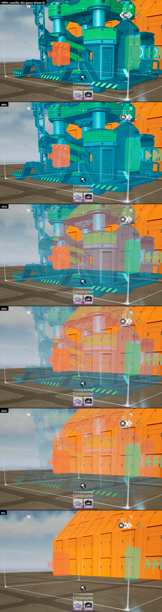
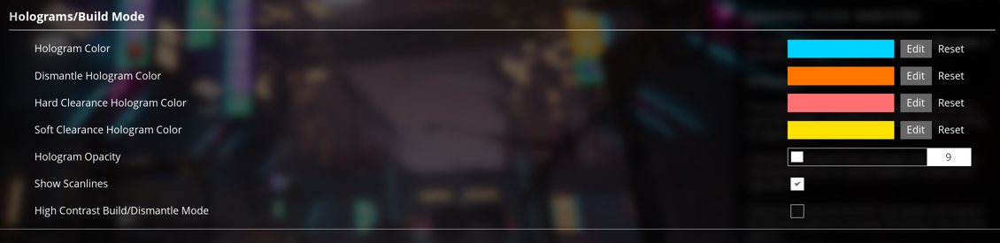

# Hologram Opacity Mod For Satisfactory

Adds **Hologram Opacity** and a **Scanlines Toggle** to build mode.
**Options > User Interface > Holograms/Build Mode**

- **100% Opacity** with **Show Scanlines** checked is the normal, vanilla hologram.
- The **Show Scanlines** toggle removes the horizontal scan lines from build mode holograms at every opacity, including 100%.
- It keeps your **Hologram Colors** settings.

## Screenshots
  

 

- The values are saved with your other options (`GameUserSettings.ini`: `HologramOpacity.Opacity` in
  `mFloatValues`, `HologramOpacity.Scanlines` as 0/1 in `mIntValues`).
- Client-side only (`RequiredOnRemote: false`)

## Requirements
- Satisfactory 1.2.5 (build 517554) or newer compatible build, Windows (Steam or Epic)
- Satisfactory Mod Loader (SML) 3.12.0 or newer 3.x

## Install
- **Satisfactory Mod Manager:** [Install from the app in one click!](https://ficsit.app/mod/54DypBRit5b39v)
- Uninstall: delete `FactoryGame\Mods\GameFeatures\HologramOpacity`.

## How it works
In Satisfactory 1.2 a hologram renders the building's own materials (textures, paint, decals, moving parts) and
writes a custom depth stencil value (5 valid, 3 soft clearance, 6 invalid). The global post process
`PPI_OutlineHologram` then recolours those pixels with the hologram colour and scan lines. That result is opaque, so
below 100%, and with scan lines off, the mod takes the hologram out of the main view and draws it itself. It never
changes a material:
- `/HologramOpacity/Settings/US_HologramOpacity` is a native `FGUserSetting` (slider 0..1, shown as 0..100, applied
  instantly) registered through the mod's `FGGameFeatureData` scan rule, so it lives in the game's own menu.
  `/HologramOpacity/Settings/US_HologramScanlines` is the "Show Scanlines" checkbox right under it.
- `UHologramOpacitySubsystem` (game instance subsystem) reads both settings every frame. It finds the hologram body
  meshes of every live `AFGHologram` (custom depth on, stencil 3/5/6, no build gun helper material) and makes them
  visible to scene captures only, so the main view and the game's post process stop drawing them. Guidelines,
  clearance boxes and connection arrows are untouched.
- A transient `SceneCapture2D` with the main view's camera, resolution and jitter (`bMainViewCamera`) draws just those
  meshes, lit and with their own materials, into `/HologramOpacity/Materials/RT_HologramOpacityCapture` (colour in
  RGB, depth in A). Lumen, ambient occlusion, screen-space reflections, fog and motion blur are off for it.
- The post process material `/HologramOpacity/Materials/M_HologramOpacityComposite`, on a transient unbound post
  process volume, draws the captured hologram in the colour from the Holograms options (the most severe state among
  the holograms on screen), with or without screen-space scan lines, and blends it over the scene at the slider's
  opacity. Where the world or a build gun helper marker (custom depth) is in front, the hologram stays behind it.
  Water is not in front: the depth test uses the world under the water surface, so a hologram standing in water
  shows through it.
- At 100% with scan lines on, every hidden mesh gets its own flag back, the capture is destroyed (the render target
  shrinks back to its asset size) and the volume switches off, so the game draws the hologram itself.
- Dismantle mode highlights a real building: the game's outline component (`UFGOutlineComponent`, outline colour
  `OC_DISMANTLE`) gives the building's own meshes custom depth stencil 8 and adds custom-depth-only copies
  ("proxies") of its instanced meshes, and the same post process tints them in the dismantle colour with a contour.
  Below 100%, or with scan lines off, the mod reads the outline's actor list and:
  - takes the building's own meshes, the outline proxies and the black fog planes in its belt openings (pooled meshes
    of the game's `APoolRoot`, found where the proxy components of the building's decorator blueprint, or its sparse
    data, put them) out of the player's view through the player controller's hidden component list, so the building
    keeps casting its shadow;
  - hides the building's shared instances in place (abstract instances with the game's own `HideInstance`, coloured
    instances such as production indicators by shrinking them) and gives the capture transient copies with the same
    mesh, materials, transform and per-instance data (paint, conveyor belt curves). Glass is the exception: a
    translucent material writes no depth, and the composite only draws captured pixels that have one, so on the copies
    glass gets the opaque `/HologramOpacity/Materials/M_HologramOpacityGlass` and window panes stay in the highlight;
  - draws all of it in the dismantle colour, with the game's contour (`EdgeIntensity`).

  When the highlight ends, or at 100% with scan lines on, every change is undone. A building that was dismantled
  while highlighted keeps its shared instances hidden, as the game wants them for its dismantle effect. When a build
  hologram and a dismantle highlight are on screen together, both use the hologram's colour.
- A capture rendered inside the main renderer would be cheaper, but in this game it trips an engine assertion in the
  Nanite base pass, so the capture runs as its own scene renderer while holograms are see-through.

### Debug console commands (in-game console, the key left of 1)
| Command | What it does |
|---|---|
| `HoloOpacity.Set <0..1 or -1>` | Override the opacity for testing; `-1` returns to the Options value |
| `HoloOpacity.Scanlines <1, 0 or -1>` | Override Show Scanlines for testing; `-1` returns to the Options value |
| `HoloOpacity.Param <Param> <value>` | Tune the composite material until the game restarts: EmissiveStrength, BaseIntensity, LineIntensity, LineCount, LineDuty, LineOpacityBoost, DetailGain, DetailFloor, DetailScale, ColorSaturation, DepthBias, DepthBiasScale, MaxHoloDepth, EdgeIntensity, EdgeWidth |
| `HoloOpacity.Dump` | Log the settings, the capture, volume and render target, every hologram mesh (body, hidden) and every dismantle highlight (proxies, own meshes, shared instances, fog planes, what the mod hides and copies) to `FactoryGame.log` |

## Credits
- Coffee Stain's modding headers
- Satisfactory Mod Loader team
- wwise-cli
- Universal Modder Skills
- Made with Claude Code.

## Bugs and feedback
Open a [GitHub issue](https://github.com/projeffpalmer/HologramOpacity/issues). Please include your game version, the
mod version, what you were building, and the lines containing `HologramOpacity` from
`%LOCALAPPDATA%\FactoryGame\Saved\Logs\FactoryGame.log`.

## License
MIT, see [LICENSE](LICENSE).
