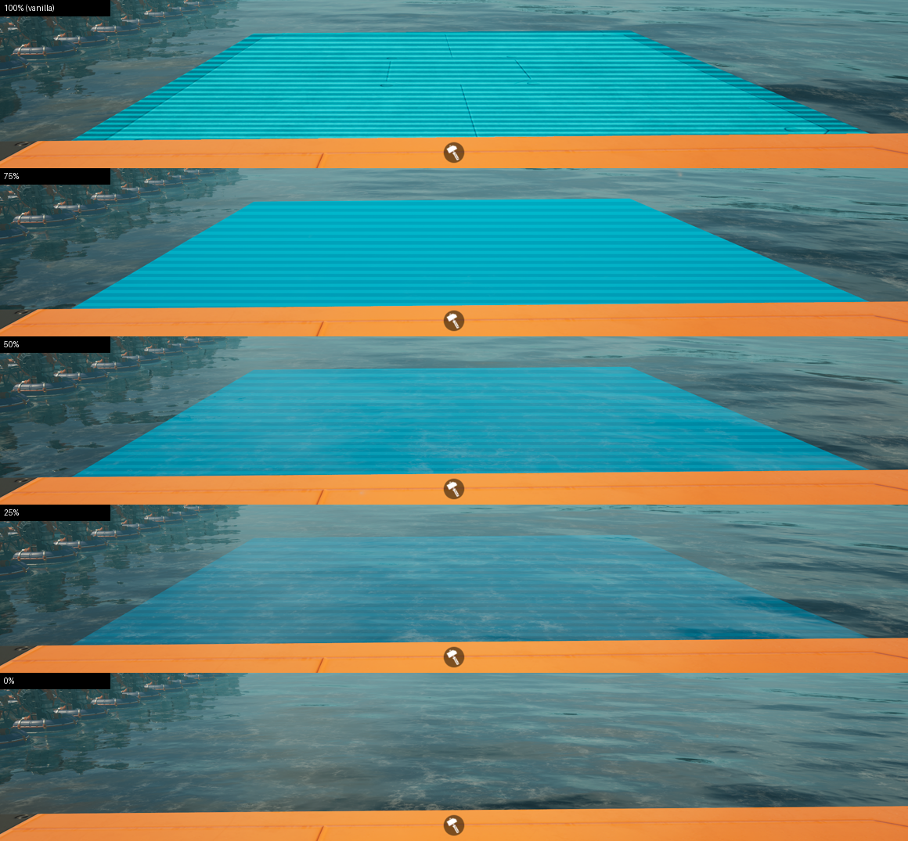

# Hologram Opacity (Satisfactory mod)

Adds a working **Hologram Opacity** slider and a **Show Scanlines** checkbox to
**Options > User Interface > Holograms/Build Mode**, so build mode holograms can be made see-through (and line-free)
while you place buildings.

- **100%** with **Show Scanlines** checked (the defaults) is the normal, vanilla hologram. The mod changes nothing then.
- **Show Scanlines** (right under the slider): unchecked removes the horizontal scan lines from build mode holograms
  at every opacity, including 100% (a clean, solid hologram in the same colour).
- Lower values fade the hologram toward fully see-through (**0%**), so you can see the ground, water, foundations
  and machines behind and under it.
- It uses your **Hologram Color**, **Soft Clearance Hologram Color** and **Hard Clearance (invalid) Hologram Color**
  from the same menu section, keeps scan lines like the vanilla look, and updates instantly.
- The values are saved with your other options (`GameUserSettings.ini`: `HologramOpacity.Opacity` in
  `mFloatValues`, `HologramOpacity.Scanlines` as 0/1 in `mIntValues`).
- Client-side only (`RequiredOnRemote: false`): other players and servers don't need it.

## Requirements
- Satisfactory 1.2.5 (build 517554) or newer compatible build, Windows (Steam or Epic)
- Satisfactory Mod Loader (SML) 3.12.0 or newer 3.x

## Install
- **Satisfactory Mod Manager:** once the mod is listed on ficsit.app, install Hologram Opacity there. SMM adds SML
  for you.
- **By hand:** extract `HologramOpacity-Windows.zip` (made by Alpakit, see Building) into a new folder
  `<Satisfactory>\FactoryGame\Mods\GameFeatures\HologramOpacity\` (so `HologramOpacity.uplugin`, `Binaries` and
  `Content` sit directly inside it). SML must already be installed. Alpakit's `HologramOpacity.zip` is the
  multi-target zip (a `Windows\` folder inside) for uploading to ficsit.app.

Uninstall: delete `FactoryGame\Mods\GameFeatures\HologramOpacity`.

Note for Windows 11 with **Smart App Control** on: a self-built mod DLL has no Microsoft reputation and can be blocked,
which makes the game refuse to load the mod. Mods published on ficsit.app are widely downloaded and pass.

## How it works
In Satisfactory 1.2 a hologram renders the building's own materials and writes a custom depth stencil value
(5 valid, 3 soft clearance, 6 invalid). The global post process `PPI_OutlineHologram` then replaces those pixels
with the hologram colour and scan lines. That replacement is opaque, so below 100% the mod draws the hologram body
itself:
- `/HologramOpacity/Settings/US_HologramOpacity` is a native `FGUserSetting` (slider 0..1, shown as 0..100, applied
  instantly) registered through the mod's `FGGameFeatureData` scan rule, so it lives in the game's own menu.
- `UHologramOpacitySubsystem` (game instance subsystem) reads the setting every frame. For every live `AFGHologram`
  it swaps the building materials on the body meshes (custom depth on, stencil 3/5/6, no build gun helper material)
  for a dynamic instance of `/HologramOpacity/Materials/M_HologramOpacity` (translucent, unlit, scan lines, fresnel),
  and turns custom depth off on those meshes so the post process leaves them alone. Guidelines, clearance boxes and
  connection arrows are untouched.
- At 100% every changed mesh is restored exactly (materials, custom depth, main pass).
- `/HologramOpacity/Settings/US_HologramScanlines` is a checkbox (`HologramOpacity.Scanlines`, default on, priority
  just under the slider). Off sets the body material's `LineIntensity`/`LineOpacityBoost` to 0 and raises
  `BaseIntensity` by the lines' average so the colour doesn't change. The vanilla lines at 100% come from the post
  process, so with lines off the mod draws hologram bodies at 100% too (fully opaque, no lines). Dismantle
  highlights are not affected.

### Debug console commands (in-game console, the key left of 1)
| Command | What it does |
|---|---|
| `HoloOpacity.Set <0..1 or -1>` | Override the opacity for testing; `-1` returns to the Options value |
| `HoloOpacity.Scanlines <1, 0 or -1>` | Override Show Scanlines for testing; `-1` returns to the Options value |
| `HoloOpacity.Mode <0..3>` | 0 vanilla meshes, 1 translucent under the post process, 2 translucent (default), 3 ghost |
| `HoloOpacity.Param custom <Param> <value>` | Tune the body material: EmissiveStrength, BaseIntensity, LineIntensity, LinePeriod, LineDuty, ScanSpeed, LineOpacityBoost, MinOpacity, FresnelExponent, FresnelBoost |
| `HoloOpacity.Rule pp <Param> <valueAt0%>` | Make a parameter of the hologram post process follow the slider |
| `HoloOpacity.Stencil <ok> <warn> <error>` | Force stencil values on hologram bodies (-1 keeps the game's) |
| `HoloOpacity.Dump` | Log the setting, materials, live holograms and post process blendables to `FactoryGame.log` |

## Building
Starter project `SatisfactoryModLoader` (game headers CL517554), Unreal Engine 5.6.1-CSS, Visual Studio 2022 17.14,
Wwise 2025.1.6 (see https://docs.ficsit.app).
1. Build `FactoryEditor Win64 Development`.
2. Create or update the content:
   `UnrealEditor-Cmd.exe FactoryGame.uproject -run=pythonscript -script="Mods/GameFeatures/HologramOpacity/Scripts/create_assets.py" -unattended`
3. Package with Alpakit, or:
   `RunUAT.bat PackagePlugin -project=<FactoryGame.uproject> -DLCName=HologramOpacity -clientconfig=Shipping -platform=Win64 -build -installed -nocompileeditor -merge -CopyToGameDirectory_Windows=<Satisfactory>`

## Credits
- Built with Coffee Stain's modding headers, the Satisfactory Mod Loader and Alpakit (SML team), wwise-cli (Mircea
  Roata), and the universal-modder toolkit.
- Made with AI assistance (Claude Code), tested in the real game.

## Bugs and feedback
Open a [GitHub issue](https://github.com/projeffpalmer/HologramOpacity/issues). Please include your game version, the
mod version, what you were building, and the lines containing `HologramOpacity` from
`%LOCALAPPDATA%\FactoryGame\Saved\Logs\FactoryGame.log`.

## License
MIT, see [LICENSE](LICENSE).
