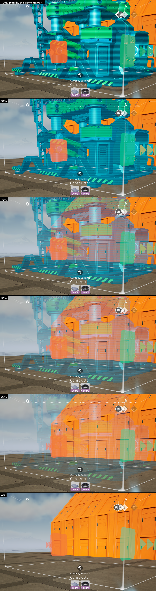

# Hologram Opacity (Satisfactory mod)

Adds a working **Hologram Opacity** slider and a **Show Scanlines** checkbox to
**Options > User Interface > Holograms/Build Mode**, so build mode holograms can be made see-through (and line-free)
while you place buildings.

- **100%** with **Show Scanlines** checked (the defaults) is the normal, vanilla hologram. The mod changes nothing then.
- **Show Scanlines** (right under the slider): unchecked removes the horizontal scan lines from build mode holograms
  at every opacity, including 100% (a clean, solid hologram in the same colour).
- Lower values fade the hologram toward fully see-through (**0%**), so you can see the ground, water, foundations
  and machines behind and under it. The hologram keeps everything the vanilla one shows: the building's textures,
  paint, decals, materials and moving parts.
- It uses your **Hologram Color**, **Soft Clearance Hologram Color** and **Hard Clearance (invalid) Hologram Color**
  from the same menu section, keeps scan lines like the vanilla look, and updates instantly.
- The values are saved with your other options (`GameUserSettings.ini`: `HologramOpacity.Opacity` in
  `mFloatValues`, `HologramOpacity.Scanlines` as 0/1 in `mIntValues`).
- Client-side only (`RequiredOnRemote: false`): other players and servers don't need it.

## Requirements
- Satisfactory 1.2.5 (build 517554) or newer compatible build, Windows (Steam or Epic)
- Satisfactory Mod Loader (SML) 3.12.0 or newer 3.x

## Install
- **Satisfactory Mod Manager:** once the mod is listed on ficsit.app, install Hologram Opacity there. SMM adds SML
  for you.
- **By hand:** extract `HologramOpacity-Windows.zip` (made by Alpakit, see Building) into a new folder
  `<Satisfactory>\FactoryGame\Mods\GameFeatures\HologramOpacity\` (so `HologramOpacity.uplugin`, `Binaries` and
  `Content` sit directly inside it). SML must already be installed. Alpakit's `HologramOpacity.zip` is the
  multi-target zip (a `Windows\` folder inside) for uploading to ficsit.app.

Uninstall: delete `FactoryGame\Mods\GameFeatures\HologramOpacity`.

Note for Windows 11 with **Smart App Control** on: a self-built mod DLL has no Microsoft reputation and can be blocked,
which makes the game refuse to load the mod. Mods published on ficsit.app are widely downloaded and pass.

## How it works
In Satisfactory 1.2 a hologram renders the building's own materials (textures, paint, decals, moving parts) and
writes a custom depth stencil value (5 valid, 3 soft clearance, 6 invalid). The global post process
`PPI_OutlineHologram` then recolours those pixels with the hologram colour and scan lines. That result is opaque, so
below 100%, and with scan lines off, the mod takes the hologram out of the main view and draws it itself. It never
changes a material:
- `/HologramOpacity/Settings/US_HologramOpacity` is a native `FGUserSetting` (slider 0..1, shown as 0..100, applied
  instantly) registered through the mod's `FGGameFeatureData` scan rule, so it lives in the game's own menu.
  `/HologramOpacity/Settings/US_HologramScanlines` is the "Show Scanlines" checkbox right under it.
- `UHologramOpacitySubsystem` (game instance subsystem) reads both settings every frame. It finds the hologram body
  meshes of every live `AFGHologram` (custom depth on, stencil 3/5/6, no build gun helper material) and makes them
  visible to scene captures only, so the main view and the game's post process stop drawing them. Guidelines,
  clearance boxes and connection arrows are untouched.
- A transient `SceneCapture2D` with the main view's camera, resolution and jitter (`bMainViewCamera`) draws just those
  meshes, lit and with their own materials, into `/HologramOpacity/Materials/RT_HologramOpacityCapture` (colour in
  RGB, depth in A). Lumen, ambient occlusion, screen-space reflections, fog and motion blur are off for it.
- The post process material `/HologramOpacity/Materials/M_HologramOpacityComposite`, on a transient unbound post
  process volume, draws the captured hologram in the colour from the Holograms options (the most severe state among
  the holograms on screen), with or without screen-space scan lines, and blends it over the scene at the slider's
  opacity. Where the world or a build gun helper marker (custom depth) is in front, the hologram stays behind it.
- At 100% with scan lines on, every hidden mesh gets its own flag back and the capture and volume switch off, so the
  game draws the hologram itself.
- A capture rendered inside the main renderer would be cheaper, but in this game it trips an engine assertion in the
  Nanite base pass, so the capture runs as its own scene renderer while holograms are see-through.

### Debug console commands (in-game console, the key left of 1)
| Command | What it does |
|---|---|
| `HoloOpacity.Set <0..1 or -1>` | Override the opacity for testing; `-1` returns to the Options value |
| `HoloOpacity.Scanlines <1, 0 or -1>` | Override Show Scanlines for testing; `-1` returns to the Options value |
| `HoloOpacity.Param <Param> <value>` | Tune the composite material until the game restarts: EmissiveStrength, BaseIntensity, LineIntensity, LinePeriod, LineDuty, LineOpacityBoost, DetailGain, DetailFloor, DetailScale, ColorSaturation, DepthBias, DepthBiasScale, MaxHoloDepth |
| `HoloOpacity.Dump` | Log the settings, the capture, volume and render target, and every hologram mesh (body, hidden) to `FactoryGame.log` |

## Building
Starter project `SatisfactoryModLoader` (game headers CL517554), Unreal Engine 5.6.1-CSS, Visual Studio 2022 17.14,
Wwise 2025.1.6 (see https://docs.ficsit.app).
1. Build `FactoryEditor Win64 Development`.
2. Create or update the content:
   `UnrealEditor-Cmd.exe FactoryGame.uproject -run=pythonscript -script="Mods/GameFeatures/HologramOpacity/Scripts/create_assets.py" -unattended`
3. Package with Alpakit, or:
   `RunUAT.bat -ScriptsForProject=<FactoryGame.uproject> PackagePlugin -project=<FactoryGame.uproject> -DLCName=HologramOpacity -clientconfig=Shipping -serverconfig=Shipping -platform=Win64 -build -installed -nocompileeditor -merge`
   (`-ScriptsForProject` loads Alpakit's `PackagePlugin` command; add `-CopyToGameDirectory_Windows=<Satisfactory>`
   to install it, with the game closed).

## Credits
- Built with Coffee Stain's modding headers, the Satisfactory Mod Loader and Alpakit (SML team), wwise-cli (Mircea
  Roata), and the universal-modder toolkit.
- Made with AI assistance (Claude Code), tested in the real game.

## Bugs and feedback
Open a [GitHub issue](https://github.com/projeffpalmer/HologramOpacity/issues). Please include your game version, the
mod version, what you were building, and the lines containing `HologramOpacity` from
`%LOCALAPPDATA%\FactoryGame\Saved\Logs\FactoryGame.log`.

## License
MIT, see [LICENSE](LICENSE).
