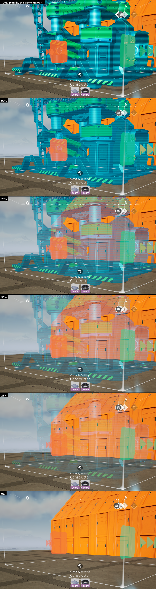
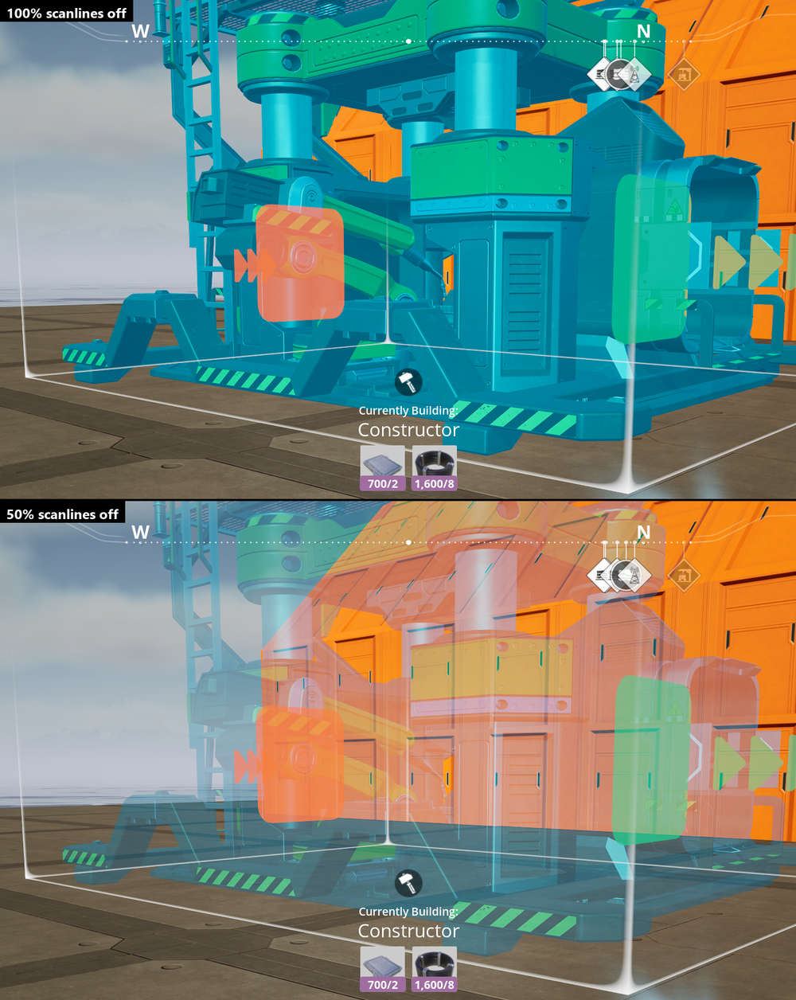
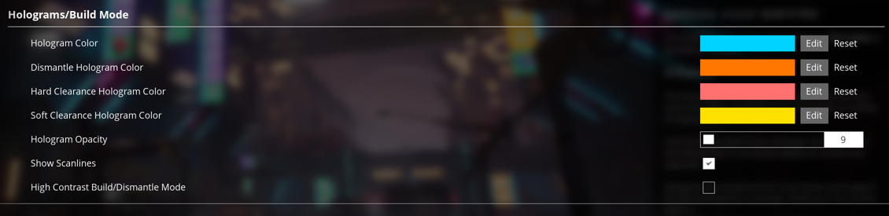

# ficsit.app listing: Hologram Opacity

Paste each part into its field on ficsit.app. Before publishing, replace `YOUR-DISCORD-TAG`. The screenshots load
from `docs/screenshots` in this repo, and bug reports go to its GitHub issues.

## Short description (107 of 128 characters; ficsit.app allows 16-128)

Adds a hologram opacity slider and a scanline toggle to Options. Retinas are non-renewable. FICSIT checked.

Alternates:
- See-through build holograms and a scanline toggle, right in Options. Pioneer feedback: "MY EYES." FICSIT: noted. (112)
- Fade build holograms and switch off the scanlines, right in Options. Save your eyesight, Pioneer. FICSIT won't. (111)

## Full description (Markdown): paste everything between the markers

<!-- BEGIN FULL DESCRIPTION -->
> **FICSIT INC. · PIONEER NOTICE HOLO-0451 · RE: BUILD MODE HOLOGRAMS**
>
> FICSIT has received 4,812,006 pioneer reports that read, in full, "MY EYES." FICSIT does not care about your eyes. FICSIT does care that a pioneer who has stared into a solid blue hologram for nine hours places foundations off-grid, and off-grid foundations waste concrete. FICSIT does not waste. A slider has therefore been approved. Reluctantly.

## What it adds

Two settings in the game's own **Options > User Interface > Holograms/Build Mode** section, right under the hologram colours:

- **Hologram Opacity** (0–100%). Turn it down to see through the hologram you are placing: the belt behind it, the foundation edge under it, the cliff you were definitely not about to build into. At 100% with scanlines on, holograms look exactly like vanilla.
- **Show Scanlines** (checked by default). Uncheck it for clean holograms without scan lines, at any opacity, 100% included. FICSIT's Visual Compliance team calls the scanlines "motivating". Pioneers report still seeing them with their eyes closed.

Also worth knowing:

- Changes apply right away. No restart, no reload. FICSIT does not believe in downtime.
- Your own hologram colours from the same menu are used, so valid, soft clearance and invalid placements still look different.
- The hologram keeps everything it shows at 100%: the building's textures, paint, decals, materials and moving parts. It just fades.
- Only the building itself fades. Connection arrows, guidelines and clearance boxes stay as they are.
- Your choices are saved with your other game settings. The mod adds nothing to your world, so it is safe to remove at any time.
- Client-side and visual only. Dedicated servers and other players don't need it.

## Screenshots

*A Constructor at 100% (vanilla), 99%, 75%, 50%, 25% and 0%. Productivity visibly unharmed.*

*Show Scanlines off, at 100% and 50%.*

*Where to find them: Options > User Interface > Holograms/Build Mode.*

## Getting started

1. Install it with Satisfactory Mod Manager, which installs SML for you.
2. Load your game. Nothing looks different yet: the defaults (100%, scanlines on) are vanilla. Pioneers who enjoy squinting may stop here.
3. Open **Options > User Interface > Holograms/Build Mode** from the main menu or the pause menu, then drag **Hologram Opacity** down and/or uncheck **Show Scanlines**.

No milestone, no M.A.M. research, no AWESOME Shop purchase. FICSIT considered charging Coupons for it. Legal said no.

**Requires:** Satisfactory 1.2.5 or later and SML 3.12 or later, on Windows.

## Not tested yet

FICSIT has not tested the following and considers that your job:

- Blueprint holograms
- Zooped foundations and walls
- Power poles and wires
- Joining someone else's game as a multiplayer client

If something there looks wrong, report it. Your sacrifice will be noted in a file nobody reads.

## Bugs and contact

FICSIT's complaints department is a hole in the ground. The mod author is slightly more responsive.

- **Bugs:** [GitHub issues](https://github.com/projeffpalmer/HologramOpacity/issues). Please include your game version, the mod version, what you were building, and any lines containing `HologramOpacity` from `%LOCALAPPDATA%\FactoryGame\Saved\Logs\FactoryGame.log`.
- **Discord:** `YOUR-DISCORD-TAG` on the Satisfactory Modding Discord.

## Credits

FICSIT will be taking credit for this mod in its next quarterly report. The people who actually made it possible:

- The Satisfactory Modding team, for SML, Alpakit, the modding Unreal Engine build and the docs.
- Coffee Stain Studios, for Satisfactory and for supporting mods.
- mircearoata, for wwise-cli, which makes the Wwise part of the modding setup survivable.
- The universal-modder toolkit, for the build-and-test workflow.
- Built with AI assistance (Claude Code by Anthropic) and tested in the real game.

---

*Not affiliated with FICSIT Inc. (which has not noticed) or Coffee Stain Studios. Pioneer eyesight is not covered by your employment contract.*
<!-- END FULL DESCRIPTION -->
